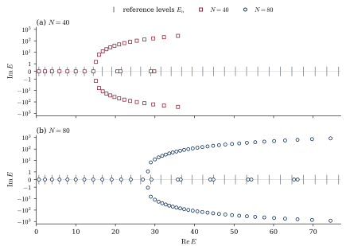

<!-- Authors: Davide Batic and Denys Dutykh (Mathematics Department, Khalifa University of Science and Technology, Abu Dhabi, UAE) -->

# Spectrum and positive metrics of the cubic ghost oscillator

**Authors:** Davide Batic, Denys Dutykh (Mathematics Department, Khalifa University of Science and Technology, Abu Dhabi, UAE)

Higher-derivative theories such as quadratic gravity contain ghosts, modes with negative canonical norm, and raise the questions of spectral stability and of a probability interpretation. The cubic ghost oscillator of Holdom (*Making sense of ghosts*, Nuclear Physics B 1008 (2024) 116696) is a quantum-mechanical model in which these questions are studied. The article constructs the closed generator of this oscillator through an explicit unitary equivalence with the imaginary cubic oscillator on the real line, and deduces that its spectrum is real, strictly positive, discrete and simple. The non-real eigenvalues found in finite truncations are therefore truncation artefacts. This repository holds the numerical material behind that statement: the code and the data of the figure of finite-truncation spectra, which sets the stable low-lying levels against the moving truncation edge, and the finite-matrix check of the complex-pair residues and of the sum rule. Every number quoted in the caption of the figure can be read in the tables of `data/` and recomputed with one command.

## The model and its compressions

The generator acts on the occupation-number basis e_0, e_1, e_2, … by

```text
H = m (a†a + ½) + c B³ ,        c = λ / (6 (2m)^(3/2)) ,
B e_n = √(n+1) e_(n+1) − √n e_(n−1) ,
```

where m > 0 is the mass, λ the cubic coupling and a†a the number operator. The finite compression of dimension N = J + 1, on the states e_0, …, e_J, is T_J = P_J H P_J, with the cube formed before the compression. The code builds the matrix P_J B³ P_J, which differs from (P_J B P_J)³ by a matrix supported on the last two states,

```text
P_J B³ P_J − (P_J B P_J)³ = (J+1) √J ( |e_(J−1)⟩⟨e_J| − |e_J⟩⟨e_(J−1)| ) .
```

The diagonal phase matrix D e_n = iⁿ e_n makes T_J similar to the compression, formed in the same way in the Hermite basis of mass m, of the imaginary cubic oscillator

```text
L = −½ d²/dx² + ½ m² x² − i (λ/6) x³ ,
```

so that the two have the same eigenvalues. The article proves that the closed operator has a real spectrum; the compressions are strongly non-normal, and their complex-conjugate pairs of eigenvalues are artefacts of the truncation. All quantities are dimensionless, and the article takes m = 1 and λ = 3.

## What the code computes

The compressions with N = 40 and N = 80, for m = 1 and λ = 3, are diagonalised in double precision, and the tables list each eigenvalue with its condition number and the relative residual of its eigenpair. The real levels of the closed operator are obtained from the compressions with N = 300 and N = 360, in decimal arithmetic with 100 and 110 digits: the determinant of T_J − E is evaluated by elimination on the band of seven diagonals around the main diagonal, and a secant iteration finds the root near each of 31 starting values. The starting values only label the roots: a root must stay within 0.01 of its seed, and the 31 roots must increase strictly. The levels E_0, …, E_30 are those on which the two compressions agree, and the highest of them is recomputed at 140 digits. An independent calculation in coordinate space, a fourth-order finite-difference discretisation of L on a box, gives the lowest levels without using the matrices.

The second computation concerns the spectral weights of the canonical two-point function of the ghost. For a compression, the weights add up to the expectation in the ground level of the double commutator [X, [T, X]] of the coordinate X = B/√(2m), taken with the indefinite form of the ghost parity, and the compression adds a boundary term to this commutator. The check forms the weights from the eigenprojections of the compression of dimension 5 (m = 1, λ = 3), which has one complex-conjugate pair of levels, and confirms, each within 2 × 10⁻¹², the boundary form of the double commutator, the equality of the sum of the weights with its ground-level expectation, the expression of the combined weight of the pair through its full complex gap, and the relation between the norm of the pair insertion and the real part of its coefficient. In the free case λ = 0 the sum is −1.

The table lists the numbers quoted in the caption of the figure, with the additional checks of the same computation, and the file that holds each of them.

| Statement | File | Value |
| --- | --- | --- |
| The 31 levels E_0, …, E_30 from the compressions with N = 300 and N = 360 agree to within 10⁻⁸ | `data/reference_levels.csv` | The largest difference is 1.7494 × 10⁻⁹, at E_30; E_0 = 0.6458770809870212 and E_30 = 76.45516055670754 |
| The highest level agrees at the two precisions | `data/arithmetic_check.csv` | At 140 digits E_30 differs from its tabulated value by 3.3 × 10⁻⁷⁸ for N = 300 and by 1.6 × 10⁻⁸⁸ for N = 360 |
| A fourth-order finite-difference calculation on [−10, 10] with spacing 0.005 reproduces the lowest level to within 2 × 10⁻¹¹ | `data/coordinate_check.csv` | The error is 1.5 × 10⁻¹¹, against 6.2 × 10⁻⁸, 3.9 × 10⁻⁹ and 2.4 × 10⁻¹⁰ for spacings 0.04, 0.02 and 0.01; it is the same for the half-widths 8, 10 and 12 at spacing 0.02 |
| The eigenvalues of the compressions with N = 40 and N = 80 (m = 1, λ = 3) | `data/spectrum_N40.csv`, `data/spectrum_N80.csv` | The first non-real pair is 15.0567161 ± 1.45265335 i for N = 40 and 28.2206364 ± 1.10622596 i for N = 80; the largest condition numbers are 9.2 × 10³ and 7.2 × 10⁷, and the relative residuals are below 1.3 × 10⁻¹⁵ |
| The sum rule and its boundary terms for the compression of dimension 5 | `data/pair_weights.json` | The weights add up to −1.0675663147, the ground-level expectation of the double commutator; the boundary form agrees to 3.6 × 10⁻¹⁵; the free sum is −1 |

## What the figure shows



The eigenvalues of the compressions with N = 40 (upper panel) and N = 80 (lower panel), for m = 1 and λ = 3, are drawn with the imaginary part on a scale that is linear for |Im E| < 1 and logarithmic outside, against the converged levels E_0, …, E_30 drawn as short bars. The low-lying real eigenvalues sit on the levels. Near the truncation edge complex-conjugate pairs appear, together with real eigenvalues that differ from the converged values, and this edge moves to higher energies as N grows.

These computations support the picture and do not prove it. The levels are real roots of finite determinants, chosen near their starting values: they are stable under a change of cutoff and of arithmetic and agree with a calculation that does not use the matrices, but they come with no error bound for the infinite-dimensional operator, and they do not count all the levels in an interval. The statements about the spectrum of the closed operator are theorems of the article. The compressions are strongly non-normal, so that the last digits of the double-precision eigenvalues near the truncation edge are rounding noise, although the tables print seventeen digits.

## Running the code

The code needs Python 3 with NumPy, SciPy and matplotlib. From the root of the repository,

```sh
python3 -m pip install -r requirements.txt
make
```

recomputes the tables of `data/`, the figure of `figures/` and `data/pair_weights.json` in a couple of seconds. The two parts also run separately, with `make spectra` and `make pairs`, or as `python3 code/truncation_spectra.py` (with the option `--skip-fd` to omit the coordinate-space calculation) and `python3 code/pair_weights.py`. No random numbers are used, and the decimal-arithmetic tables do not depend on the machine; the double-precision spectra agree to the accuracy that their condition numbers allow.

## Contents

| Path | What it holds |
| --- | --- |
| `code/ghost_compressions.py` | The compression in double precision and in decimal arithmetic, the determinant and the secant iteration, and the finite-difference calculation |
| `code/truncation_spectra.py` | The tables and the figure of the truncation spectra |
| `code/pair_weights.py` | The finite-matrix check of the pair weights and of the sum rule |
| `data/starting_guesses.csv` | The 31 starting values, the lowest levels to sixteen digits |
| `data/spectrum_N40.csv`, `data/spectrum_N80.csv` | The real and imaginary parts, the condition number and the relative residual of each eigenvalue |
| `data/reference_levels.csv` | The 31 levels from the compressions with N = 300 and N = 360, as exact decimal strings, with their differences |
| `data/arithmetic_check.csv` | The highest level recomputed at 140 digits |
| `data/coordinate_check.csv` | The finite-difference levels, with box half-width, spacing and error against the N = 360 level |
| `data/pair_weights.json` | The quantities of the pair-weight check |
| `figures/` | The figure of the article as vector PDF, and the same figure as SVG for this page |

## Licence

Copyright (C) 2026 Davide Batic and Denys Dutykh. The code and the data are distributed under the GNU Lesser General Public License, version 2.1; see `LICENSE`. Please cite the article *Spectrum and positive metrics of the cubic ghost oscillator* when using them.
